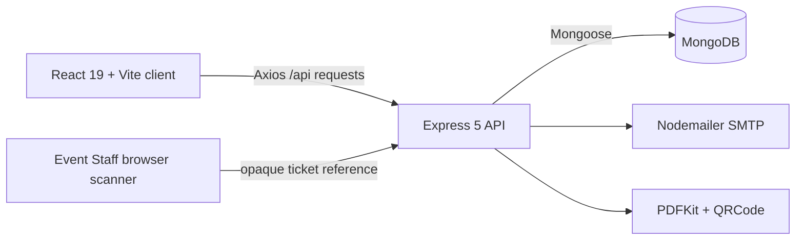

# Architecture and Project Structure

## Runtime architecture



The client uses React Router, Axios, and Tailwind CSS. The Vite development
server proxies `/api` to Express on port 5000. In production, `VITE_API_URL`
can point Axios to an API base ending in `/api`; without it the client uses
relative `/api` URLs. `vercel.json` maps `/api/*` to the server service and
other paths to the Vite-built client.

Express connects to MongoDB before processing API requests. Authentication
middleware validates JWTs, loads the current User document, and checks the
current role and token version. Controllers validate requests and call Mongoose
models and services. Booking and reservation logic does not rely on multi-
document MongoDB transactions.

## Repository map

```text
client/src/
  components/       Navbar, TicketScanner
  context/          AuthContext and session handling
  pages/            public, user, admin, and Event Staff screens
  utils/            Axios client, booking forms, scanner parsing, navigation
server/
  controllers/      auth, events, bookings, staff, and tickets
  middleware/       JWT roles, password-reset limits, cron authorization
  models/           User, Event, Booking, OTP, PasswordReset,
                    EventStaffAssignment, Ticket
  routes/           Express route registration
  services/         reservations, ticket issuance/PDF, staff permissions,
                    booking confirmation email
  scripts/          guarded development-only index migration
  test/             Node built-in test runner tests
docs/               current implementation and operations documentation
```

See [`API_CONTRACT.md`](API_CONTRACT.md) for the registered route table and
[`DATABASE_SCHEMA.md`](DATABASE_SCHEMA.md) for collection shapes and schema-
declared indexes.

## Request and booking sequence

```mermaid
sequenceDiagram
  participant U as User browser
  participant A as Express API
  participant E as Event document
  participant B as Booking document
  participant T as Ticket collection
  U->>A: POST /api/bookings/send-otp
  A-->>U: OTP email attempt result
  U->>A: POST /api/bookings (event, OTP, quantity, attendees)
  A->>B: Create pending/reserving booking
  A->>E: Atomic seat decrement + capacity claim
  alt Paid event
    A->>B: Mark reserved; expiry = now + 24 hours
    A-->>U: Pending booking
    Note over A,B: Admin confirms later; capacity is not decremented again
  else Free event
    A->>B: Mark confirmed/consumed
    A->>T: Idempotently issue attendee tickets
    A-->>U: Confirmed booking
  end
```

Paid approval issues tickets and emails only after confirmation. Rejection,
cancellation, expiry, and interrupted writes are reconciled through the
capacity-claim workflow described in [`RESERVATION_POLICY.md`](RESERVATION_POLICY.md).

## Authorization boundaries

- Public event browsing is available without a token. If a token is supplied,
  it is validated; Event Staff see assigned event scope only.
- `protect` loads the current account from MongoDB and checks `tokenVersion`.
  `admin` and `eventStaff` middleware enforce current database roles.
- Booking history uses the authenticated user's ID. Only the booking owner or
  an admin can cancel it; only admins can approve a paid booking.
- Event Staff can read assigned event projections and check tickets in only
  for currently assigned events. Admins can check in for any event.
- Ticket PDF downloads require ticket ownership or admin authorization.
- Frontend route guards improve navigation but are not a security boundary;
  backend middleware and resource checks remain authoritative.

## Error handling and consistency limits

Routes return JSON for API errors; ticket routes include a stable `code` and
`message`. Other controllers primarily return `{ "message": "..." }`, and
status/detail consistency varies by route. The client must handle non-2xx
responses. Reservation safety is not cross-document atomicity: interrupted
booking/event writes can remain transitional until maintenance reconciliation.
The implementation does not establish whether any deployed MongoDB supports
transactions and does not depend on them.
