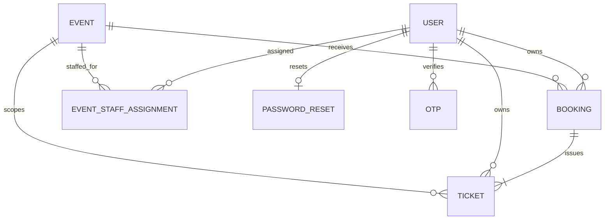

# Database Schema and Index Safety

This document describes Mongoose schemas in `server/models/`. Mongoose
declarations describe application requirements; they do **not** prove an
index exists in any running database. No database index state was inspected
for this documentation update.

## Collections and relationships



Mongoose's default collection names are `users`, `events`, `bookings`,
`tickets`, `eventstaffassignments`, `passwordresets`, and `otps`.

## Models

| Model | Important fields and semantics |
|---|---|
| `User` | `name`, unique `email`, bcrypt `password`, `role` (`user`, `event_staff`, `admin`), `isVerified`, `tokenVersion`, optional `passwordChangedAt`, and hidden `passwordResetOperationId`; timestamps. Public registration always assigns `user`. |
| `Event` | `title`, `description`, `date`, `location`, `category`, integer `totalSeats`/`availableSeats`, `ticketPrice` (nonnegative amount with at most two decimal places), INR-only `currency`, optional `image`, `createdBy`, embedded `capacityClaims`, and legacy capacity-release markers; timestamps. |
| `Booking` | `userId`, `eventId`, optional event snapshots and `bookingReference`, integer `quantity` (legacy default 1), `unitPrice`, INR `currency`, total `amount`, `status` (`pending`, `confirmed`, `cancelled`), `paymentStatus` (`paid`, `not_paid`), `capacityState`, expiry/reason, attendee snapshots, confirmation-email delivery state, and timestamps. Legacy documents may not contain the newer snapshots or reference. |
| `Ticket` | Unique random `ticketReference`, booking/event/user references, `attendeeIndex`, attendee and event snapshots, `unitPrice`, currency, `status` (`active`, `void`), `issuedAt`, nullable `checkedInAt` and `checkedInBy`, timestamps. No ticket expiration date is modeled. |
| `EventStaffAssignment` | Required `userId`, `eventId`, and `assignedBy`, plus timestamps. One assignment links one staff account to one event. |
| `PasswordReset` | Unique user reference and token hash, expiry, `state` (`active`, `processing`, `consumed`), and internal operation metadata. Raw reset tokens are not stored. |
| `OTP` | Email, six-digit code, action (`account_verification` or `event_booking`), `createdAt` with a five-minute TTL index. MongoDB TTL deletion is asynchronous; application checks still reject invalid/expired codes. |

There is no separate `Registration` model. A `Booking` is the registration
record. Attendee emails are optional snapshots, not the notification
recipient: booking confirmation mail is sent only to the verified booking
owner's stored account email.

## Schema-declared indexes

| Collection | Key | Options / purpose |
|---|---|---|
| `users` | `{ email: 1 }` | `unique: true` |
| `tickets` | `{ ticketReference: 1 }` | `unique: true`, declared on the field |
| `tickets` | `{ bookingId: 1, attendeeIndex: 1 }` | `unique: true`; one ticket per booking attendee index |
| `eventstaffassignments` | `{ userId: 1, eventId: 1 }` | `unique: true`; prevents duplicate assignments |
| `eventstaffassignments` | `{ eventId: 1, userId: 1 }` | Non-unique reverse lookup index |
| `passwordresets` | `{ userId: 1 }` | `unique: true` |
| `passwordresets` | `{ tokenHash: 1 }` | `unique: true`, field excluded from normal selection |
| `otps` | `{ createdAt: 1 }` | TTL `expireAfterSeconds: 300` |

`_id` indexes are created by MongoDB. Booking has no unique user/event index;
the active per-event claim on the Event document serializes new duplicate
booking attempts. Do not infer production or development index existence from
this table.

## Database environments and release safety

- The intended local development database name is `eventhub_dev`. The seed
  refuses to run unless `NODE_ENV=development`, the URI host is loopback, and
  the database name matches an allowed development pattern. It also requires
  the unique staff assignment index and checks duplicate assignment pairs.
  The one-time index migration separately checks missing/null fields and
  duplicate pairs before index creation. Despite its checks, never point the
  seed at production.
- The existing main/production database name and its deployment environment
  are **not established by this repository**. Verify them from the actual
  deployment configuration using an authorized, secret-safe process. Do not
  assume a database name or reuse the local seed configuration.
- A Git merge copies source changes; it does not merge MongoDB data. Preserve
  existing users, events, bookings, relationships, and ticket records.
- Before any live data transition, require a verified backup and a tested,
  reviewed migration/reconciliation plan. No destructive operation is allowed
  without explicit authorization.

## Index migration and verification

The application schema declares these indexes, but actual index state must be
checked independently in each database. In MongoDB Compass, select the
intended database, open the collection, then open the **Indexes** tab and
compare each key and uniqueness/TTL option above. This is read-only. In
particular, confirm `eventstaffassignments` has unique
`{ userId: 1, eventId: 1 }` and inspect `tickets` and `passwordresets` indexes.
Do not claim indexes exist unless Compass or an authorized read-only database
inspection confirms them.

The one-time script `server/scripts/createEventStaffAssignmentUniqueIndex.js`
is narrowly restricted to `NODE_ENV=development`, loopback `localhost` or
`127.0.0.1` on port 27017, and database `eventhub_dev`. It checks missing/null
assignment fields, duplicate pairs, and conflicting same-key indexes before
creating only the unique `{ userId: 1, eventId: 1 }` index. It refuses to
delete, merge, or rewrite records. It was not run as part of this documentation
update. Only after a separately approved review and a duplicate-free Compass
inspection, the local command is:

```powershell
Set-Location D:\Projects\EventHub\server
$env:NODE_ENV = 'development'
node scripts/createEventStaffAssignmentUniqueIndex.js
```

The script reads `server/.env`; verify that its URI is the local
`eventhub_dev` target without printing it. Reopen the collection's Indexes tab
to verify the result. Do not run this command against any other database.

The seed script checks for, but does not create, the EventStaffAssignment
unique index. The `Ticket` issuance and password reset flows call their
Mongoose `createIndexes()` methods. These runtime calls are not proof that
other declared indexes exist in a deployed database; index creation can fail
if existing data conflicts. Treat index state and deployment migration as
operational tasks.
